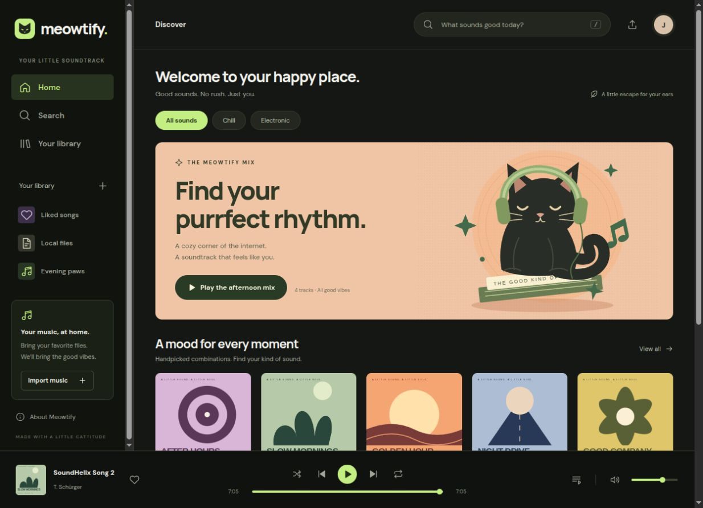

# Meowtify — your purrfect rhythm

A Spotify-inspired music player with a cozy cat identity, real audio playback, curated mixes, and your own local music.

**[Web app setup and source](web/README.md)** · **[Hosted preview](https://meowtify-joyson.splendidcloak.chatgpt.site)** *(private; owner access may be required)*



## Web music player

- Eight credited SoundHelix tracks and seven curated mixes, with original illustrated artwork.
- Search, liked songs, custom playlists, and a responsive library.
- Play/pause, seeking, previous/next, shuffle, repeat, volume, and an editable queue.
- Import local audio without uploading it. Local files remain available for the current session.
- Save playlists, likes, and recent listening in your browser.
- No backend, API key, account setup, or build step required to run locally.

### Run locally

From the repository root, using Python 3:

```sh
python3 -m http.server 4188 --bind 127.0.0.1 --directory web/dist
```

Open http://127.0.0.1:4188. Use HTTP rather than opening `index.html` directly.

### Verify

Requires Node.js 18 or newer:

```sh
node --check web/dist/app.mjs
node --check web/dist/core.mjs
node --test web/tests/*.test.mjs
```

Online music streams from SoundHelix; source availability and internet access affect playback. Imported files need to be selected again after reload. Saved browser data does not sync across devices. Meowtify is independent of Spotify and does not provide Spotify catalogue access.

## Credits

Web collection: **T. Schürger / [SoundHelix](https://www.soundhelix.com/audio-examples)**, used with the source's attribution permission. Mix names and artwork are Meowtify creations. See [content and privacy details](web/README.md#content-and-privacy).

## Original Python desktop project

The original application remains in `Modify (Extra Project).py`, with its existing `Imagees/` and `Songs/` folders. Its original documentation follows.

---

# Music Player In Python

Creating a Music Player in Python using Tkinter in GUI.

**Library Used:**
- Tkinter
- Webbrowser
- Pygame
- PIL

Made By J.A.VA (Joyson).

The songs used in this do not belong to me. Credit to the song artists.
